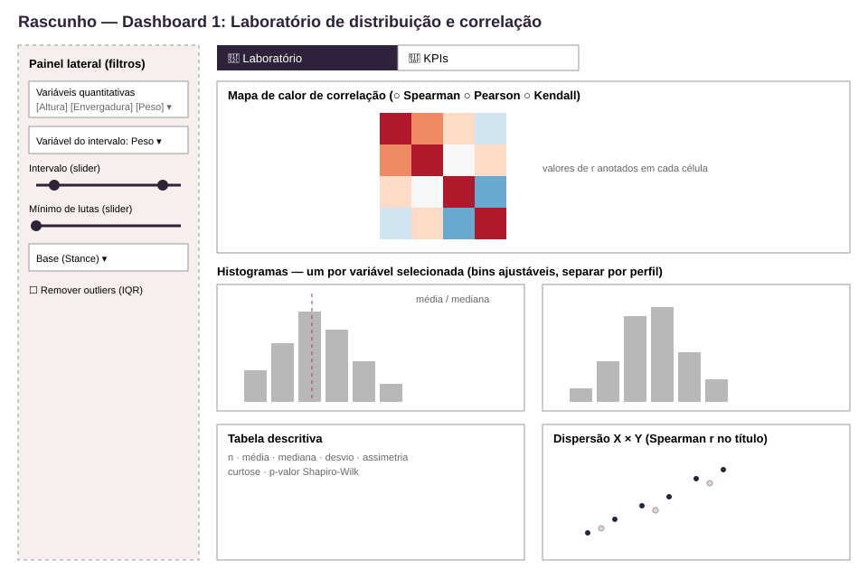
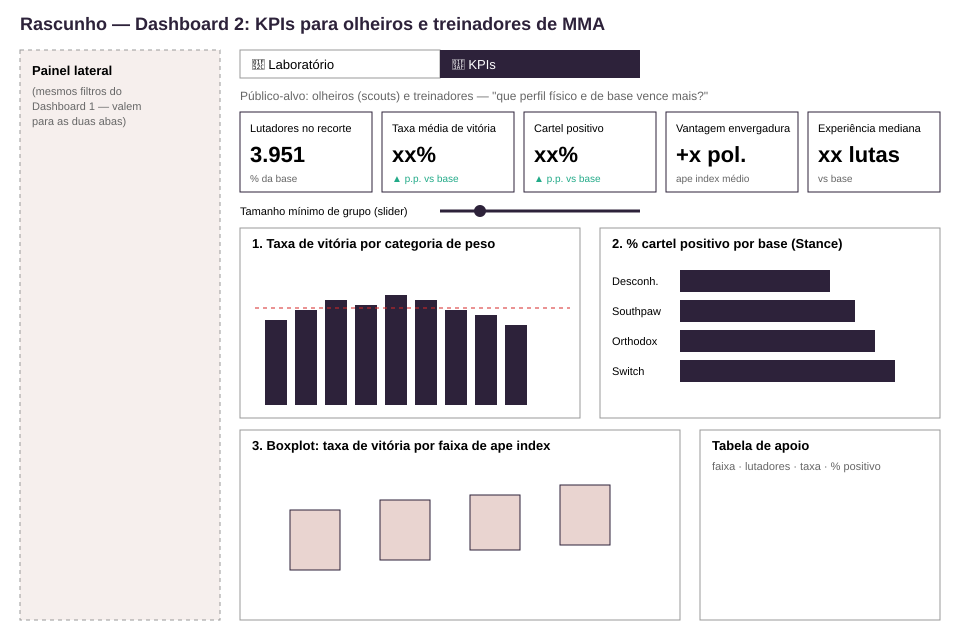

# Entregas — rascunhos dos dashboards

| Arquivo | Conteúdo |
|---|---|
| [rascunho_dashboard1.svg](rascunho_dashboard1.svg) | Wireframe do **Dashboard 1 — Laboratório de distribuição e correlação** |
| [rascunho_dashboard2.svg](rascunho_dashboard2.svg) | Wireframe do **Dashboard 2 — KPIs para olheiros e treinadores de MMA** |

## Dashboard 1 — Laboratório

- **Pergunta:** como as características físicas e de cartel dos lutadores se distribuem e se relacionam?
- **Visuais:** mapa de calor de correlação (Spearman, Pearson ou Kendall), um histograma por variável quantitativa selecionada (com boxplot marginal, média e mediana), tabela descritiva com assimetria, curtose e Shapiro-Wilk, e dispersão livre X × Y.

## Dashboard 2 — KPIs

- **Público-alvo:** olheiros (scouts) e treinadores de academias de MMA.
- **Pergunta:** que perfil físico e que base de luta estão associados a um cartel vencedor?
- **Métricas (5):** lutadores no recorte, taxa média de vitória, % com cartel positivo, vantagem de envergadura média (ape index), experiência mediana. Todas comparadas com a base completa.
- **Visuais (3):** taxa de vitória por categoria de peso, % de cartel positivo por base (Stance), boxplot da taxa de vitória por faixa de ape index.

## Painel lateral (comum às duas abas)

- Seletor de variáveis quantitativas
- Filtro de intervalo (slider) sobre a variável escolhida
- Slider de mínimo de lutas no cartel
- Filtro de base (Stance) e opção de remover outliers pela regra do IQR
